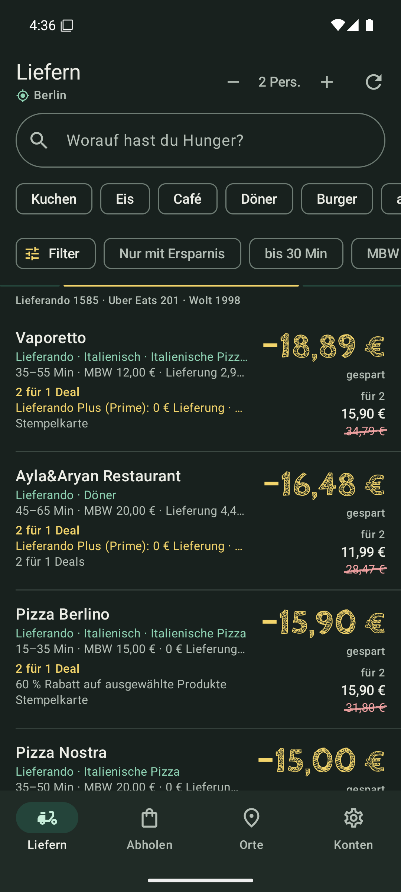
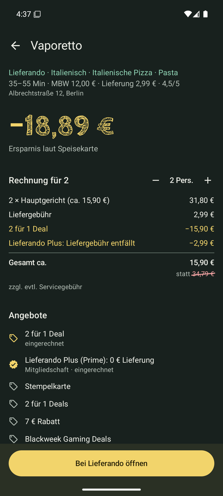
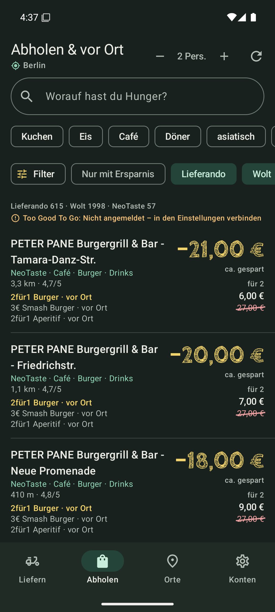
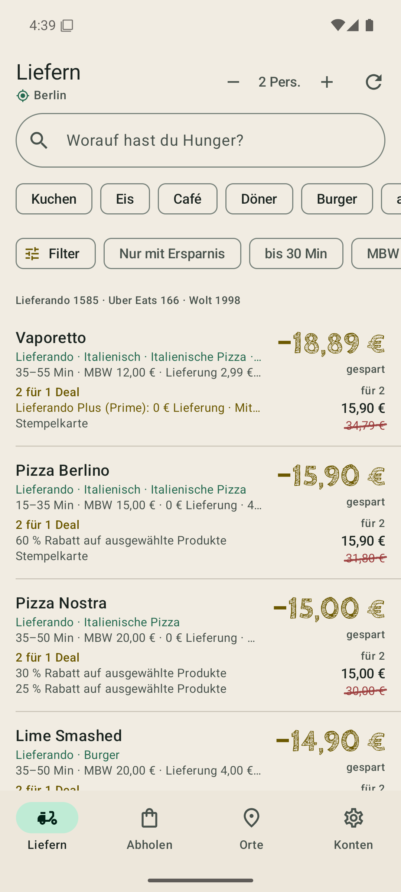
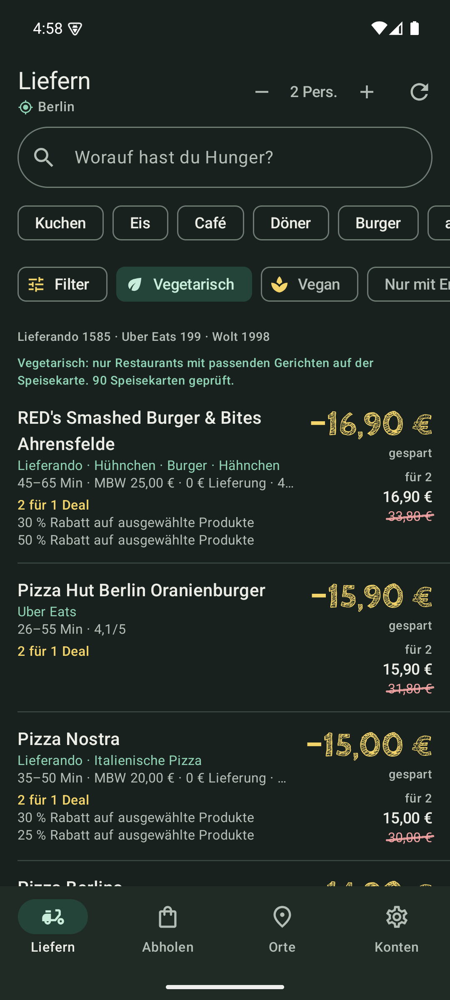
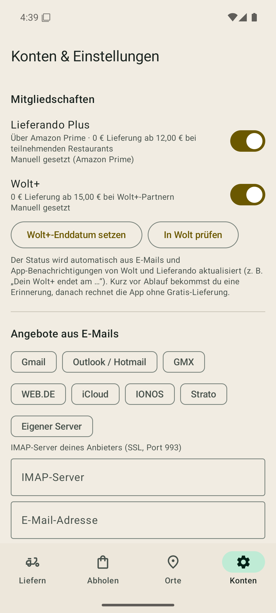

# FoodFinder

**Find the best food deals near you, ranked by how much money they actually save.** FoodFinder is a native Android app (Kotlin, Jetpack Compose, Material 3) that compares food delivery coupons and pickup deals from **Lieferando, Uber Eats, Wolt, NeoTaste and Too Good To Go** at your current location. It is a standalone APK: no server, no PC, no Google Play Services.

`food deals` `delivery coupons` `Lieferando` `Uber Eats` `Wolt` `Too Good To Go` `NeoTaste` `Android` `Kotlin` `Jetpack Compose`

[English](#foodfinder) | [Deutsch](#deutsch)

- [Features](#features)
- [Screenshots](#screenshots)
- [How savings are calculated](#how-savings-are-calculated)
- [Setup](#setup)
- [Install](#install)
- [Build from source](#build-from-source)
- [Project structure](#project-structure)
- [Privacy](#privacy)
- [Limitations and honesty notes](#limitations-and-honesty-notes)
- [Disclaimer](#disclaimer)
- [Contributing](#contributing)
- [License](#license)

## Features

- **Deals ranked by estimated savings**, for your GPS position or any saved place.
- **Delivery:** Lieferando, Uber Eats, Wolt.
- **Pickup and dine-in:** Lieferando (pickup), Wolt (pickup), NeoTaste, Too Good To Go (reads the official TGTG app's screen, see [Setup](#setup)).
- **Per-restaurant estimate for N persons** (default 2), including minimum order, delivery fee, the best restaurant deal, memberships and vouchers.
- **Real menus for the top results:** the app loads the actual menu to list individually discounted products and to make the estimate exact instead of guessed.
- **Vegetarian / vegan filter** that checks individual dishes on the real menus (service labels like "vegetarian" / "VEGAN" plus dish-name rules), not the restaurant's cuisine type. Restaurants stay in the list only if they have matching main dishes, and the bill is estimated from those dishes.
- **Vouchers and membership status from your own data:** read from your mailbox via IMAP and from the delivery apps' push notifications. Wolt+ gets an expiry reminder.
- **E-mail login:** Sign in with Google (Gmail) via OAuth (read-only Gmail scope) – or any other provider via IMAP with an app password.
- **Search and filters:** time-of-day suggestions, recent searches and cuisine synonyms. Filter by cuisine, delivery time, minimum order, delivery fee, rating and service; hide groceries. Sort by savings, total, ETA, distance or rating.
- **Background checks** (WorkManager, every 30 minutes to 4 hours) with notifications for new top deals.
- **Ordering stays in the original app** via deep link.
- **German UI**, light and dark theme, designed as a market-stall chalkboard: slate ground, chalk-white text, chalk-yellow savings in the Cabin Sketch font, and the old price struck through with a chalk stroke.
- **App icon:** a footprint made of pizza – a wink at the name.

## Screenshots

<table>
  <tr>
    <td align="center"><br><sub>Delivery, dark</sub></td>
    <td align="center"><br><sub>Detail, dark</sub></td>
    <td align="center"><br><sub>Pickup, dark</sub></td>
    <td align="center"><br><sub>Delivery, light</sub></td>
    <td align="center"><br><sub>Vegetarian filter</sub></td>
    <td align="center"><br><sub>Settings, light</sub></td>
  </tr>
</table>

## How savings are calculated

For every restaurant, FoodFinder builds an estimated bill for N persons and compares it with what you would pay without any deal.

1. **Main dish price:** the typical (median) main-dish price from the menu, or, if no menu is available, an estimate from the restaurant's price level. Drinks, dips and similar items are ignored.
2. **Regular total:** N main dishes, topped up to the minimum order (delivery only), plus the delivery fee.
3. **Best restaurant deal:** the single most valuable deal is subtracted: 2-for-1, percent off, euros off, free item or free delivery. Deals are not stacked, since services usually exclude combining them.
4. **Memberships:** Lieferando Plus (including via Amazon Prime) and Wolt+ make delivery free when the restaurant and minimum order qualify.
5. **Vouchers:** the best matching voucher read from e-mail or push notifications is added on top. The app notes that it may not combine with the restaurant deal.
6. **Ranking:** results are ranked by savings, with a penalty for money you would have to add just to reach a high minimum order.

Too Good To Go is handled separately: savings are the bag's stated value minus its price. For the top results the real menu is loaded, so discounted products are listed individually and the saving is exact rather than estimated. Estimated values are labeled as such ("ca.").

## Setup

All of this lives in the **Konten** (accounts) tab.

| What | Purpose |
|---|---|
| **Memberships** | Switch Lieferando Plus (e.g. via Prime) and Wolt+ on or off and set the Wolt+ end date. The status is updated automatically from e-mails and push notifications. A reminder appears shortly before Wolt+ expires. |
| **Gmail** | Tap "Mit Google anmelden". One-time setup: create a Google Cloud project, enable the Gmail API, set the OAuth consent screen to "External" with your address as test user, then publish the app (otherwise the login expires after 7 days; Google shows an "unverified app" notice that you continue through via "Advanced"). Create an OAuth client of type "Desktop app" and paste the Client ID and Client secret into the app. Developers can instead put `google.clientId` and `google.clientSecret` into `local.properties` (not committed) to bake them into their own build. |
| **Other e-mail providers (IMAP)** | Choose your provider, enter your e-mail address and an **app password**, then tap "Speichern & scannen". Only mails from the supported services (and Amazon regarding Lieferando) from the last 3 weeks are read; vouchers and codes are picked up. The password is stored encrypted with the Android Keystore. |
| **Notification access** | Tap "Zugriff freigeben" and enable FoodFinder. Deals from the delivery apps' push notifications then feed into the calculation. |
| **Too Good To Go (via the original app)** | Tap "Mitlesen einschalten" under "Too Good To Go (über die Original-App)", enable the service "FoodFinder: Too Good To Go mitlesen" in Android's accessibility settings, then open the TGTG app once and scroll through the bags. Bags seen within the last 4 hours appear under "Abholen". Bags announced by the TGTG app's push notifications are shown too (notification access). |
| **Notifications** | Choose the minimum saving that triggers an alert and how often to check (30 minutes to 4 hours). Allow location and notifications on first start. |

## Install

1. Download `FoodFinder.apk` from the [GitHub Releases](../../releases) page.
2. Open it on your phone and allow installing from this source (unknown sources).
3. Install, then grant location and notification permissions on first start.

Requires Android 9 (API 28) or newer.

## Build from source

Requirements: JDK 17 and Android SDK 35.

```bash
./gradlew assembleRelease
```

The APK is written to `app/build/outputs/apk/release/app-release.apk`.

Live tests against the real service endpoints (need network access, may fail if a service changes):

```bash
./gradlew testDebugUnitTest --tests "*LiveSourcesTest*"
```

## Project structure

```
app/src/main/java/de/foodfinder
├── FoodFinderApp.kt        application class
├── MainActivity.kt         entry point
├── data/
│   ├── sources/            one client per service (Sources.kt)
│   ├── Http.kt             HTTP helpers
│   ├── Locator.kt          GPS / saved places
│   ├── Models.kt           venues, deals, estimates
│   ├── Prefs.kt            settings and encrypted credentials
│   ├── Repository.kt       loading and combining sources
│   └── Savings.kt          deal parsing and savings estimate
├── mail/                   IMAP scan for vouchers and membership (MailScanner, Signals)
├── notify/                 notifications (Notify.kt)
└── ui/                     Compose screens: deals, detail, places, settings
    └── theme/              chalkboard theme (Theme.kt)
```

## Privacy

Everything stays on your device. There is no backend, no analytics and no tracking. Your mailbox is read directly from the phone: via Gmail's API with a read-only Google sign-in (tokens stored encrypted with the Android Keystore), or over IMAP with an app password (also stored encrypted). Only mails from the supported services are processed. Too Good To Go bags are read by an Android accessibility service that is limited to the TGTG app and is read-only: it reads only that app's screen while you browse it, never taps, types or scrolls, and reads no other app. Requests go directly from your phone to the services' public web endpoints.

## Limitations and honesty notes

- **No official APIs.** The services do not offer public APIs for this. FoodFinder uses the same public web endpoints as their websites. If a service changes something, the source is shown as unavailable and the app may break until it is updated.
- **Anonymous public deals only.** Without a login, Lieferando, Wolt and Uber Eats expose only public deals. Personal vouchers come in through e-mail and push notifications.
- **Lieferando item-level discounts are estimated.** For offers like "X % on selected products" without a product list, the value is estimated (half the discount on main dishes), because Lieferando shows the list only in its app.
- **Wolt checkout banner:** a discount banner seen at Wolt checkout is treated as a possible new-customer offer, not a guaranteed saving.
- **Estimates are estimates.** Prices, fees and deal conditions can differ at checkout (for example service fees). Always check the final price in the original app.
- **Too Good To Go blocks third-party apps.** FoodFinder therefore does not log in to Too Good To Go or call its API, and does not try to bypass its protection. It only reads what the official TGTG app shows (see [Setup](#setup)). The list is only as fresh as the last time the TGTG app was opened, and screen reading may need an update when Too Good To Go changes its app layout.

## Disclaimer

FoodFinder is an independent project. It is not affiliated with, endorsed by or sponsored by Lieferando / Just Eat Takeaway.com, Uber (Uber Eats), Wolt / DoorDash, Too Good To Go or NeoTaste. All trademarks and brand names belong to their respective owners. Please use the app responsibly and respect the terms of service of the services involved.

## Contributing

Issues and pull requests are welcome. If a source stops working, please open an issue with the service name and what you see in the app. Before submitting a change, build the project and run the unit tests; for source fixes, the live tests above help to confirm the endpoint still behaves as expected.

## License

The code is released under the [GNU General Public License v3.0 or later](LICENSE) (`GPL-3.0-or-later`). The font Cabin Sketch (bundled from google/fonts) is licensed under the SIL Open Font License.

---

# Deutsch

**Die besten Essens-Deals an deinem Ort, sortiert nach echter Ersparnis.** FoodFinder ist eine native Android-App (Kotlin, Jetpack Compose, Material 3), die Lieferando, Uber Eats, Wolt, NeoTaste und Too Good To Go vergleicht. Eigenständige APK: kein Server, kein PC, keine Google Play Services.

## Funktionen

- Deals nach geschätzter Ersparnis sortiert, für deinen GPS-Standort oder gespeicherte Orte.
- **Liefern:** Lieferando, Uber Eats, Wolt. **Abholen:** Lieferando (Abholung), Wolt (Abholung), NeoTaste, Too Good To Go (über die Original-App mitlesen).
- Schätzung pro Restaurant für N Personen (Standard 2), inklusive Mindestbestellwert, Liefergebühr, bestem Restaurant-Deal, Mitgliedschaften und Gutscheinen.
- Für die vorderen Treffer wird die echte Speisekarte geladen: reduzierte Produkte werden einzeln gezeigt, die Ersparnis ist dann exakt.
- Filter Vegetarisch / Vegan, der die einzelnen Gerichte auf den echten Speisekarten prüft (Kennzeichnungen der Dienste plus Regeln für Gerichtnamen), nicht die Küchenart des Restaurants. Restaurants bleiben nur in der Liste, wenn sie passende Hauptgerichte haben; die Rechnung wird aus diesen Gerichten geschätzt.
- Gutscheine und Mitgliedsstatus aus deinem eigenen Postfach (IMAP) und aus den Push-Benachrichtigungen der Liefer-Apps. Erinnerung vor Ablauf von Wolt+.
- E-Mail-Anmeldung: Mit Google (Gmail) per OAuth anmelden (nur Lesezugriff auf Gmail) – oder ein anderer Anbieter per IMAP mit App-Passwort.
- Suche mit Vorschlägen nach Tageszeit, letzten Suchen und Küchen-Synonymen. Filter: Küche, Lieferzeit, Mindestbestellwert, Liefergebühr, Bewertung, Dienst, Supermärkte ausblenden. Sortierung nach Ersparnis, Gesamtpreis, Lieferzeit, Entfernung oder Bewertung.
- Hintergrundprüfung (30 Minuten bis 4 Stunden) mit Benachrichtigung bei neuen Top-Deals.
- Deutsche Oberfläche, heller und dunkler Modus, Design als Marktstand-Kreidetafel. Bestellt wird immer in der Original-App (Deep Link).
- **App-Icon:** ein Fußabdruck aus Pizza – ein Augenzwinkern zum Namen.

## So wird gerechnet

- Pro Person ein Hauptgericht zum mittleren Preis der Karte (oder geschätzt nach Preisklasse), aufgefüllt auf den Mindestbestellwert, plus Liefergebühr.
- Davon wird der beste Restaurant-Deal abgezogen (2 für 1, Prozent, Euro, Gratis-Produkt, Gratis-Lieferung; Rabatte schließen sich meist aus). Dazu kommen Gratis-Lieferung durch Mitgliedschaften (Lieferando Plus, auch über Prime; Wolt+) und Gutscheine aus E-Mails und Pushs.
- Hohe Mindestbestellwerte drücken den Rang, damit kein 70-Euro-Mindestumsatz für zwei Personen oben landet.
- Too Good To Go: Warenwert der Tüte minus Preis.

## Einrichten (Tab "Konten")

- **Mitgliedschaften:** Lieferando Plus und Wolt+ an oder aus, Wolt+-Enddatum. Der Status wird aus E-Mails und App-Pushs aktualisiert.
- **Gmail:** "Mit Google anmelden" antippen. Einmalige Einrichtung: ein Google-Cloud-Projekt anlegen, die Gmail-API aktivieren, den OAuth-Zustimmungsbildschirm auf "Extern" stellen, die eigene Adresse als Testnutzer eintragen und die App dann veröffentlichen (sonst läuft die Anmeldung nach 7 Tagen ab; Google zeigt einen Hinweis "nicht verifizierte App", über "Erweitert" geht es weiter). Einen OAuth-Client vom Typ "Desktopanwendung" anlegen und Client-ID und Client-Geheimnis in die App einfügen. Entwickler können stattdessen `google.clientId` und `google.clientSecret` in `local.properties` eintragen (nicht committen), um sie in den eigenen Build einzubauen.
- **Andere Anbieter (IMAP):** Anbieter wählen, E-Mail und **App-Passwort** eintragen, "Speichern & scannen". Gelesen werden nur Mails der unterstützten Dienste aus den letzten 3 Wochen. Das Passwort liegt verschlüsselt im Android Keystore.
- **App-Benachrichtigungen mitlesen:** "Zugriff freigeben", dann FoodFinder aktivieren.
- **Too Good To Go (über die Original-App):** "Mitlesen einschalten" antippen, dann den Dienst "FoodFinder: Too Good To Go mitlesen" in den Android-Bedienungshilfen aktivieren. Danach die TGTG-App einmal öffnen und durch die Tüten scrollen. Tüten, die in den letzten 4 Stunden gesehen wurden, erscheinen unter "Abholen". Tüten aus den Push-Benachrichtigungen der TGTG-App werden ebenfalls angezeigt (Benachrichtigungszugriff).
- **Benachrichtigungen:** Ab welcher Ersparnis gemeldet wird und wie oft geprüft wird.

## Installieren

1. `FoodFinder.apk` von der [GitHub-Releases-Seite](../../releases) laden.
2. Auf dem Handy öffnen und "Aus dieser Quelle installieren" erlauben.
3. Installieren, beim ersten Start Standort und Benachrichtigungen erlauben. Voraussetzung: Android 9 oder neuer.

## Bauen

Voraussetzungen: JDK 17, Android SDK 35.

```bash
./gradlew assembleRelease
```

APK: `app/build/outputs/apk/release/app-release.apk`. Live-Tests der Datenquellen: `./gradlew testDebugUnitTest --tests "*LiveSourcesTest*"`.

## Datenschutz

Alles bleibt auf dem Gerät. Kein Backend, keine Analyse- oder Tracking-Dienste. Das Postfach wird direkt vom Handy gelesen: per Google-Anmeldung mit reinem Lesezugriff auf Gmail oder per IMAP mit App-Passwort; Zugangsdaten liegen verschlüsselt im Android Keystore. Verarbeitet werden nur Mails der unterstützten Dienste. Der Bedienungshilfen-Dienst für Too Good To Go ist auf die TGTG-App beschränkt und nur lesend: Er liest den Bildschirm dieser App beim Stöbern, tippt, schreibt und scrollt nie und liest keine andere App.

## Grenzen

- Die Dienste haben keine offiziellen Schnittstellen. Die App nutzt dieselben öffentlichen Web-Endpunkte wie die Websites. Ändert ein Dienst etwas, wird die Quelle als nicht erreichbar angezeigt, und die App kann ausfallen, bis sie angepasst ist.
- Ohne Login sind nur öffentliche Deals sichtbar. Persönliche Gutscheine kommen über E-Mail und App-Pushs dazu.
- Bei Lieferando sind "-X % auf ausgewählte Produkte" ohne Produktliste geschätzt, weil Lieferando die Liste nur in der App zeigt.
- Das Wolt-Banner im Checkout wird als mögliches Neukunden-Angebot behandelt, nicht als sichere Ersparnis.
- Alle Werte sind Schätzungen. Den Endpreis immer in der Original-App prüfen.
- **Too Good To Go blockiert Drittanbieter-Apps.** FoodFinder meldet sich daher nicht bei Too Good To Go an und ruft deren Schnittstelle nicht auf, und versucht nicht, den Schutz zu umgehen. Die App liest nur, was die offizielle TGTG-App anzeigt (siehe Einrichten). Die Liste ist nur so aktuell wie das letzte Öffnen der TGTG-App, und das Auslesen des Bildschirms muss eventuell angepasst werden, wenn Too Good To Go das Layout ändert.

## Haftungsausschluss

FoodFinder ist ein unabhängiges Projekt und steht in keiner Verbindung zu Lieferando / Just Eat Takeaway.com, Uber (Uber Eats), Wolt / DoorDash, Too Good To Go oder NeoTaste und wird von diesen nicht unterstützt oder empfohlen. Alle Marken gehören ihren jeweiligen Inhabern. Bitte nutze die App verantwortungsvoll und beachte die Nutzungsbedingungen der Dienste.

## Mitmachen und Lizenz

Issues und Pull Requests sind willkommen. Der Code steht unter der [GNU General Public License v3.0 oder später](LICENSE) (`GPL-3.0-or-later`); die Schrift Cabin Sketch (aus google/fonts) unter der SIL Open Font License.
